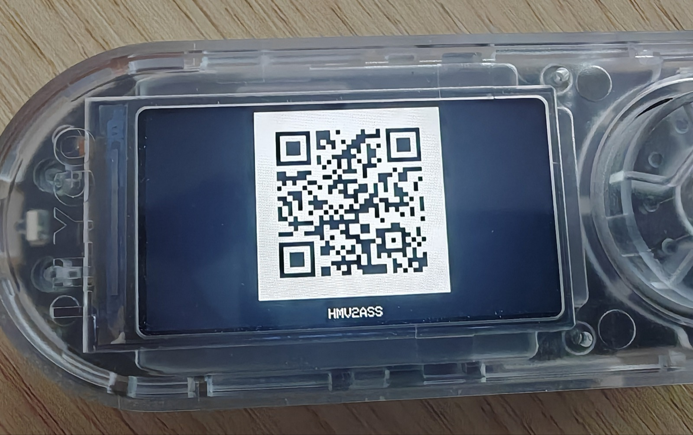
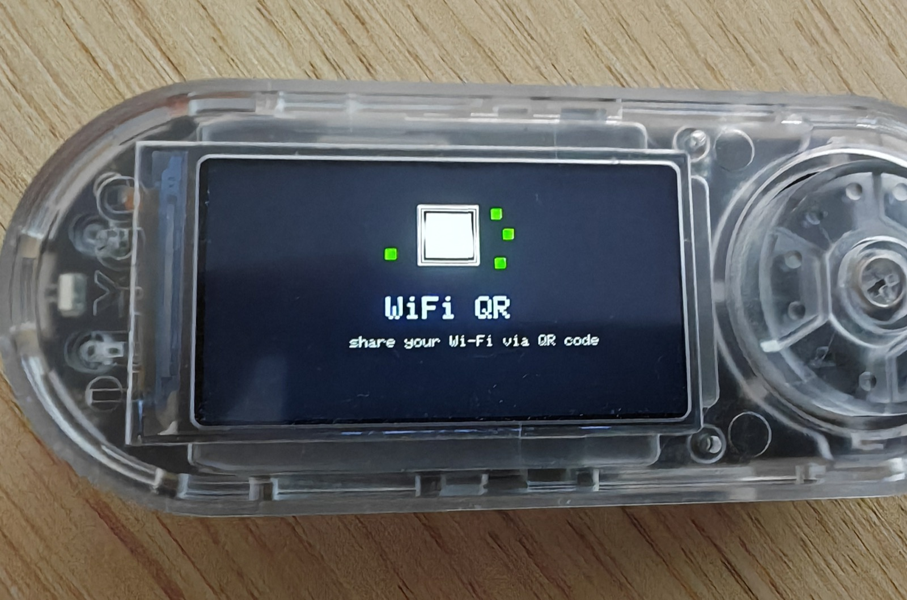
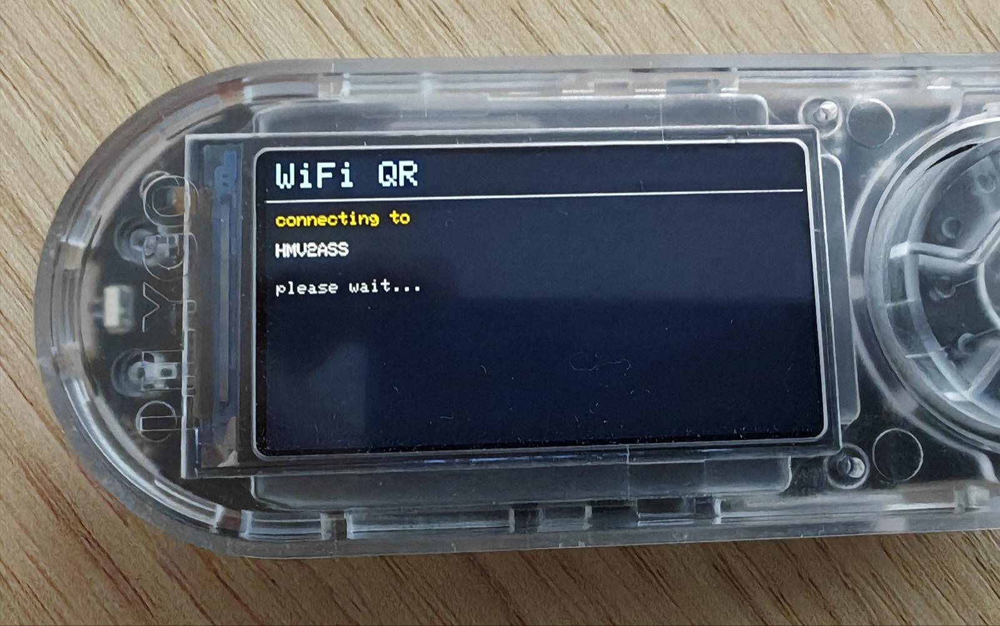

# 📶 WiFi QR — Bruce / LilyGO T-Embed CC1101

🇺🇸 <a href="README.md">English</a> · 🇫🇷 <b>Français</b>

  [-F7DF1E)](https://github.com/BruceDevices/firmware) 

Connecte-toi à un réseau Wi-Fi, puis affiche un **QR code scannable** de ce réseau à l'écran. Un invité pointe simplement l'appareil photo de son téléphone dessus pour se connecter — sans rien taper. Le QR est généré par un encodeur QR écrit de zéro qui tourne sur l'appareil (sans PC, sans internet, sans support QR natif).

## ✨ Fonctionnement

- **Déjà connecté ?** → il affiche tout de suite le QR de ton réseau actuel.
- **Pas connecté ?** → il liste les réseaux à proximité ; choisis-en un, il s'y connecte d'abord (mot de passe repris des réseaux enregistrés dans Bruce, ou saisi), puis affiche le QR.
- Les mots de passe viennent de la configuration de Bruce (`/bruce.conf`, clé `wifi`) : pour les réseaux enregistrés, tu n'as même pas à les retaper.

| Intro | Connexion | QR |
|---|---|---|
|  |  |  |

## 🧠 L'encodeur QR

L'interpréteur JS de Bruce n'a **aucun support natif du QR (ni du PNG)** : le QR est donc entièrement construit en JavaScript — segmentation en mode octet, correction d'erreurs Reed–Solomon sur GF(256), construction de la matrice et choix automatique du masque. C'est un portage ES5 compact du **[QR Code generator de Nayuki](https://www.nayuki.io/page/qr-code-generator-library)** (MIT), **vérifié sur PC** en redécodant chaque code généré avec le décodeur `jsQR`. Il est réutilisable pour tout besoin de QR (URL, carte de contact vCard, texte…).

## 🚀 Installation

1. Copie **`WiFi QR.js`** sur la carte SD (par ex. `/scripts` ou `/BruceJS`).
2. Sur l'appareil : **JS Interpreter → sélectionne `WiFi QR.js`** (ou ajoute-le à tes favoris avec [bruce-launcher](https://github.com/koua29/bruce-launcher)).
3. **Molette** = se déplacer · **clic** = choisir · **ESC** = retour/quitter.

## 🔒 Confidentialité

Le script lit les mots de passe Wi-Fi enregistrés **sur ton propre appareil** pour construire le QR, et le QR contient lui-même le mot de passe (c'est tout l'intérêt de le partager). À utiliser pour **tes propres** réseaux / tes invités. Ne publie pas une capture d'un QR dont le mot de passe est toujours valable.

## 🛒 Matériel

*Liens partenaires Amazon : si vous achetez via ces liens, le projet touche une petite commission, sans surcoût pour vous.*

<table>
<tr>
<td align="center" width="33%">
   
  <b><a href="https://www.amazon.fr/dp/B0D45MSMJR?linkCode=ll2&amp;tag=koua29bwifiqr-21&amp;ref_=as_li_ss_tl">Batterie Anker 545 (10 000 mAh)</a></b> Pour faire tourner le T-Embed loin d'une prise
</td>
<td align="center" width="33%">
   
  <b><a href="https://www.amazon.fr/dp/B0C1FCZM94?linkCode=ll2&amp;tag=koua29bwifiqr-21&amp;ref_=as_li_ss_tl">Antenne SMA 433 MHz (lot de 2)</a></b> Antenne sub-GHz pour la radio CC1101
</td>
<td align="center" width="33%">
   
  <b><a href="https://www.amazon.fr/dp/B0B7NVMBPL?linkCode=ll2&amp;tag=koua29bwifiqr-21&amp;ref_=as_li_ss_tl">microSD SanDisk 64 Go (lot de 2)</a></b> Pour les thèmes, scripts et captures Bruce
</td>
</tr>
</table>

En tant que Partenaire Amazon, je réalise un bénéfice sur les achats remplissant les conditions requises.

## 🙏 Crédits & licence

- Script : **koua29**. Tourne sur l'excellent **[Bruce firmware](https://github.com/BruceDevices/firmware)**.
- Encodeur QR porté du **[QR Code generator de Nayuki](https://www.nayuki.io/page/qr-code-generator-library)** (MIT).
- Publié sous **licence MIT** — voir [LICENSE](LICENSE).

## ☕ Un café ?

