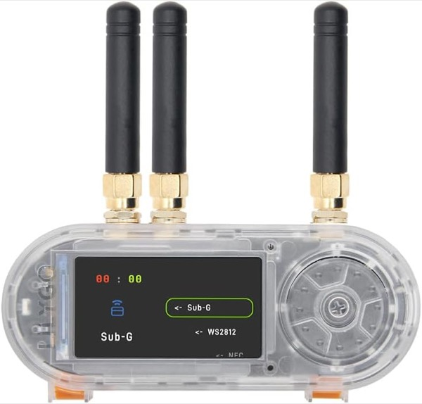
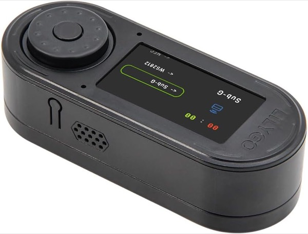
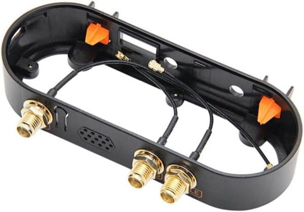

# 📶 WiFi QR — Bruce / LilyGO T-Embed CC1101

  [-F7DF1E)](https://github.com/BruceDevices/firmware) 

> **EN** — Connect to a Wi-Fi network, then show a **scannable QR code** of it on the screen. A guest just points their phone camera at it to join — no typing. The QR is rendered by a from-scratch QR encoder running on the device (no PC, no internet, no native QR support needed).

> **FR** — Connecte-toi à un réseau Wi-Fi, puis affiche un **QR code scannable** de ce réseau à l'écran. Un invité pointe simplement l'appareil photo de son téléphone dessus pour se connecter — sans rien taper. Le QR est généré par un encodeur QR maison qui tourne sur l'appareil (sans PC, sans internet).

## ✨ How it works / Fonctionnement

- **Already connected?** → it shows the QR of your current network right away.
- **Not connected?** → it lists nearby networks; pick one, and it connects first (password taken from Bruce's saved networks, or typed), then shows the QR.
- Passwords come from Bruce's own config (`/bruce.conf`, key `wifi`), so for saved networks you don't even retype them.

| Intro | Connecting | QR |
|---|---|---|
|  |  |  |

## 🧠 The QR encoder

Bruce's JS interpreter has **no native QR (nor PNG) support**, so the QR is built entirely in JavaScript: byte-mode segmentation, Reed–Solomon error correction over GF(256), matrix construction, and automatic mask selection. It's a compact ES5 port of **[Nayuki's QR Code generator](https://www.nayuki.io/page/qr-code-generator-library)** (MIT), **verified on PC** by decoding every generated code back with the `jsQR` decoder. It's reusable for any QR need (URL, contact vCard, text…).

## 🚀 Install

1. Copy **`WiFi QR.js`** onto the SD card (e.g. `/scripts` or `/BruceJS`).
2. On the device: **JS Interpreter → select `WiFi QR.js`** (or add it to your favorites with [bruce-launcher](https://github.com/koua29/bruce-launcher)).
3. **Rotate** = move · **click** = select · **ESC** = back/quit.

## 🔒 Privacy

This reads the Wi-Fi passwords stored **on your own device** to build the QR, and the QR itself encodes the password (that's the point of sharing it). Use it for **your own** networks / guests. Don't publish a screenshot of a QR of a network whose password is still live.

## 🛒 Matériel / Hardware

Le matériel utilisé pour ce projet — liens affiliés Amazon :

|  |  |  |
|:---:|:---:|:---:|
| 🔌 **[LilyGO T-Embed CC1101](https://link.amazon/B0cgD7wou)** avec antennes | ⬛ **[LilyGO T-Embed CC1101](https://link.amazon/B071fmsbH)** noir, sans antenne | 📡 **[Kit d'antennes SMA](https://link.amazon/B0eMlSqeZ)** |

En tant que Partenaire Amazon, je réalise un bénéfice sur les achats remplissant les conditions requises. · As an Amazon Associate I earn from qualifying purchases.

## 🙏 Credits & License

- Script: **koua29**. Runs on the excellent **[Bruce firmware](https://github.com/BruceDevices/firmware)**.
- QR encoder ported from **[Nayuki's QR Code generator](https://www.nayuki.io/page/qr-code-generator-library)** (MIT).
- Released under the **MIT License** — see [LICENSE](LICENSE).

## ☕ Coffee?

