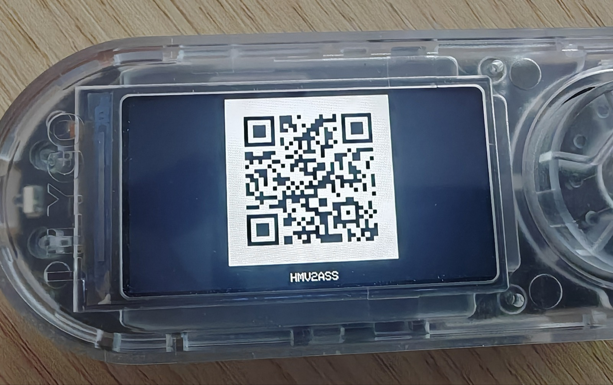
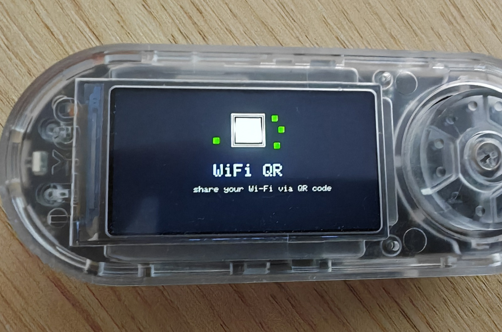
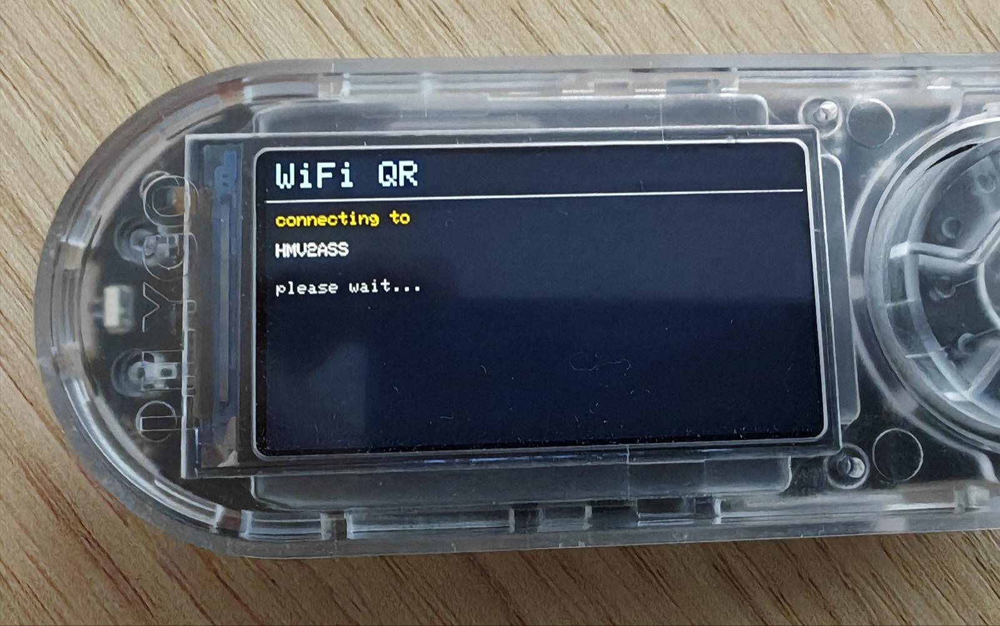

# 📶 WiFi QR — Bruce / LilyGO T-Embed CC1101

🇺🇸 <b>English</b> · 🇫🇷 <a href="README.fr.md">Français</a>

  [-F7DF1E)](https://github.com/BruceDevices/firmware) 

Connect to a Wi-Fi network, then show a **scannable QR code** of it on the screen. A guest just points their phone camera at it to join — no typing. The QR is rendered by a from-scratch QR encoder running on the device (no PC, no internet, no native QR support needed).

## ✨ How it works

- **Already connected?** → it shows the QR of your current network right away.
- **Not connected?** → it lists nearby networks; pick one, and it connects first (password taken from Bruce's saved networks, or typed), then shows the QR.
- Passwords come from Bruce's own config (`/bruce.conf`, key `wifi`), so for saved networks you don't even retype them.

| Intro | Connecting | QR |
|---|---|---|
|  |  |  |

## 🧠 The QR encoder

Bruce's JS interpreter has **no native QR (nor PNG) support**, so the QR is built entirely in JavaScript: byte-mode segmentation, Reed–Solomon error correction over GF(256), matrix construction, and automatic mask selection. It's a compact ES5 port of **[Nayuki's QR Code generator](https://www.nayuki.io/page/qr-code-generator-library)** (MIT), **verified on PC** by decoding every generated code back with the `jsQR` decoder. It's reusable for any QR need (URL, contact vCard, text…).

## 🚀 Install

1. Copy **`WiFi QR.js`** onto the SD card (e.g. `/scripts` or `/BruceJS`).
2. On the device: **JS Interpreter → select `WiFi QR.js`** (or add it to your favorites with [bruce-launcher](https://github.com/koua29/bruce-launcher)).
3. **Rotate** = move · **click** = select · **ESC** = back/quit.

## 🔒 Privacy

This reads the Wi-Fi passwords stored **on your own device** to build the QR, and the QR itself encodes the password (that's the point of sharing it). Use it for **your own** networks / guests. Don't publish a screenshot of a QR of a network whose password is still live.

## 🛒 Hardware

*Amazon affiliate links: if you buy through these links, the project earns a small commission at no extra cost to you.*

<table>
<tr>
<td align="center" width="33%">
   
  <b><a href="https://www.amazon.com/dp/B0D45MSMJR?linkCode=ll2&amp;tag=koua29bwifiqr-20&amp;ref_=as_li_ss_tl">Anker 545 power bank (10,000 mAh)</a></b> Keeps the T-Embed running away from an outlet
</td>
<td align="center" width="33%">
   
  <b><a href="https://www.amazon.com/dp/B0C1FCZM94?linkCode=ll2&amp;tag=koua29bwifiqr-20&amp;ref_=as_li_ss_tl">433 MHz SMA antenna (2-pack)</a></b> Sub-GHz antenna for the CC1101 radio
</td>
<td align="center" width="33%">
   
  <b><a href="https://www.amazon.com/dp/B0B7NVMBPL?linkCode=ll2&amp;tag=koua29bwifiqr-20&amp;ref_=as_li_ss_tl">SanDisk 64 GB microSD (2-pack)</a></b> For Bruce themes, scripts and captures
</td>
</tr>
</table>

As an Amazon Associate I earn from qualifying purchases.

## 🙏 Credits & License

- Script: **koua29**. Runs on the excellent **[Bruce firmware](https://github.com/BruceDevices/firmware)**.
- QR encoder ported from **[Nayuki's QR Code generator](https://www.nayuki.io/page/qr-code-generator-library)** (MIT).
- Released under the **MIT License** — see [LICENSE](LICENSE).

## ☕ Coffee?

